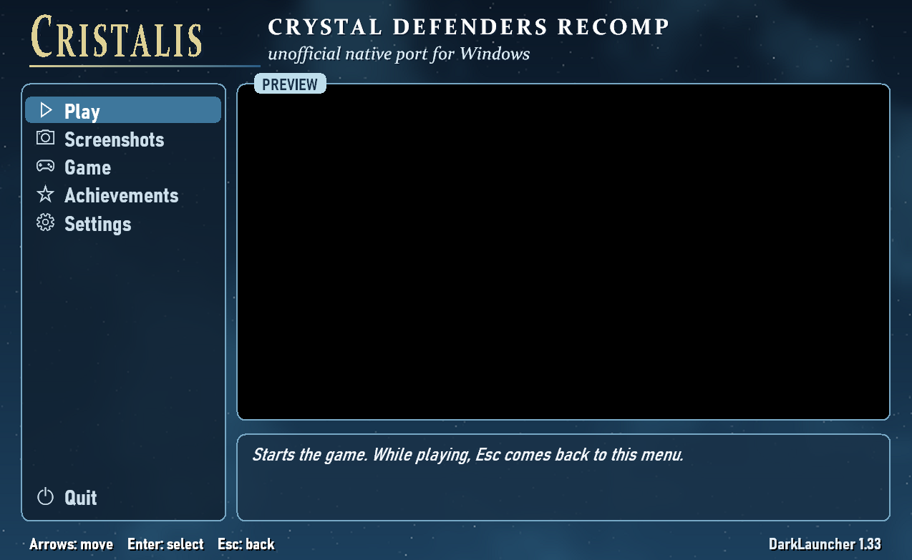
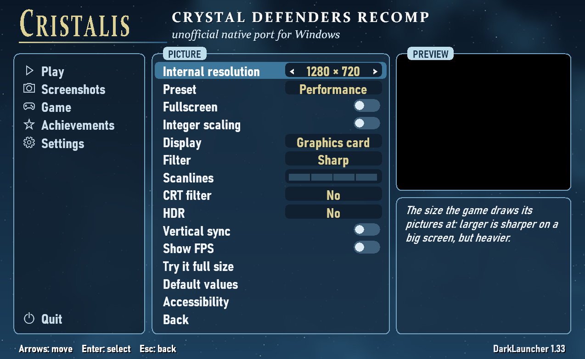

# Cristalis

**Crystal Defenders Recomp — conversione nativa tramite ricompilazione statica**

*[English](README.md) · [Français](README.fr.md) · [Deutsch](README.de.md) · [Español](README.es.md) · **Italiano** · [日本語](README.ja.md)*

Questo progetto fa girare Crystal Defenders, il gioco Xbox Live Arcade, come un programma nativo per
Windows: il codice PowerPC del gioco viene tradotto in anticipo in C++ con
[XenonRecomp](https://github.com/hedge-dev/XenonRecomp) e gira su un piccolo ambiente scritto solo
per questo gioco. Una versione per Linux è sperimentale.

**Non è inclusa alcuna risorsa del gioco**, né in questo repository né nelle release: immagini,
suoni, musica e testi vengono letti dalla tua copia del gioco. Il repository non contiene nemmeno
codice del gioco: il codice tradotto viene generato da un `default.xex` quando si compila il
programma, e i programmi della [pagina delle release](https://github.com/Claudio5702/Cristalis/releases/latest) sono compilati così. **Versione 1.10,
una beta**: finora giocata da poche persone.

**Ti serve la tua copia di Crystal Defenders (Xbox 360).** Crystal Defenders appartiene a Square
Enix; questo progetto non è affiliato a Square Enix né approvato da essa.

**Indice:** [Giocare](#giocare) · [Funzioni](#funzioni) ·
[Schermata delle impostazioni](#schermata-delle-impostazioni) · [Comandi](#comandi) · [File](#file) ·
[Disinstallare](#disinstallare) · [Linux](#linux) · [Limiti noti](#limiti-noti) ·
[Per gli sviluppatori](#per-gli-sviluppatori) · [Domande frequenti](#domande-frequenti) ·
[Programmi](#programmi) · [Licenza](#licenza) · [Ringraziamenti](#ringraziamenti)

## Giocare

Scarica l'ultima versione dalla [pagina delle release](https://github.com/Claudio5702/Cristalis/releases/latest), e solo da lì:
`Cristalis-Setup.exe` per Windows, `Cristalis-linux-x86_64.tar.gz` per Linux.

1. Copia il gioco dalla tua console: la cartella `CRYSTAL DEFENDERS` (o la cartella con
   l'identificativo del titolo, `58410989`) così come si trova nella memoria della console, per
   esempio su una chiavetta USB.
2. Con il programma di installazione: metti quella cartella accanto a `Cristalis-Setup.exe`
   e avvialo. Il gioco viene installato da essa, con collegamenti e una voce nell'elenco delle app di
   Windows. Senza la cartella, l'ultima finestra del programma di installazione chiede dove si trova.
3. Compilato da te, senza il programma di installazione: avvia `crystal_defenders.exe`. Al primo avvio chiede quella
   cartella (o una cartella che contenga già `default.xex` e `Media`), oppure la prende subito se si
   trova accanto al programma.

I dati del gioco vengono poi conservati in una cartella `game` accanto al programma; la cartella
della console non serve più. Tieni questi file per te.

Windows 10 o 11, 64 bit, una scheda grafica Direct3D 11.

### Il gioco da usare

| | |
| --- | --- |
| Identificativo del titolo | `58410989` (Xbox Live Arcade) |
| Pacchetto della console | `58410989\000D0000\18F4739D37853F8596CE621540680922AFE9F23A`, 58.126.336 byte, SHA-1 `118C64C901976CD8E2B570D77B0A5E01C15C7A46` |
| `default.xex` al suo interno | 1.658.880 byte, SHA-1 `31A90704D4233F6E730714515CD5F20BF08D7F0D` |

Il programma controlla che `default.xex` sia quello da cui è stato tradotto il suo codice, e lo
segnala se non lo è.

## Funzioni

- **Il gioco in [DarkLauncher](kit/launcher)**, il launcher creato
  per Kahna (Bahamut Lagoon Recomp): una schermata delle impostazioni prima del gioco e un menu di
  pausa durante la partita, in sette lingue, con tastiera, controller o mouse. Il suo aspetto segue
  la direzione artistica del gioco: il blu delle sue finestre, l'oro dei suoi cristalli, una notte
  stellata. DarkLauncher disegna tutto da sé; nulla è preso dai file del gioco.
- **Le sei lingue del gioco** (francese, inglese, tedesco, spagnolo, italiano, giapponese), scelte
  nelle impostazioni; il gioco si riavvia nella nuova lingua.
- **Immagine tramite la scheda grafica**: il gioco disegnato a 1280×720, 1920×1080, 2560×1440 o
  3840×2160, poi nitido, sfumato o con bordi ammorbiditi a qualsiasi dimensione della finestra; HDR (Windows).
- **Obiettivi salvati sul computer**, con un avviso sopra il gioco e un elenco nelle impostazioni.
- **Il comportamento offline della console, su richiesta**: l'avviso «Non connesso a Xbox LIVE» e
  la scelta del dispositivo di memorizzazione sono disattivati per impostazione predefinita e si
  possono attivare.
- **Screenshot** dell'immagine così come è mostrata, filtri compresi, e una galleria nelle
  impostazioni.
- **Controller**: Xbox (XInput), e PlayStation 4 e 5 letti direttamente (USB o Bluetooth), con
  vibrazione su entrambi; tasti e pulsanti scelti nella pagina Comandi. Un controller PlayStation 3
  richiede il driver DsHidMini.
- **Un rapporto di crash** che dice dov'era la partita («W1, Stage 2, Wave 5»), scritto all'avvio successivo.
- **Un programma di installazione e uno di disinstallazione**, in sei lingue.
- **Aggiornamenti**: a ogni avvio il launcher controlla se c'è una nuova versione e propone di
  installarla; nulla viene installato finché non scegliete «Aggiorna». Si disattiva in
  Impostazioni, Internet.

## Schermata delle impostazioni

All'avvio DarkLauncher mostra la sua schermata delle impostazioni, con il gioco in esecuzione
nell'anteprima. **Gioca** lo avvia; durante la partita, **Esc** (o il pulsante View del controller,
tenuto premuto) apre un menu di pausa sopra l'immagine ferma: riprendi la partita, screenshot,
impostazioni, esci.

Una barra a sinistra riunisce Gioca, Screenshot, Opzioni, Obiettivi e Impostazioni, con Esci in fondo;
la pagina della voce selezionata appare accanto. Invio o Destra vi entra, Esc torna indietro.

- **Screenshot**: gli screenshot scattati, dal più recente. Invio ne apre uno, Canc due volte lo
  sposta nel Cestino.
- **Opzioni**: l'avviso «Non connesso a Xbox LIVE» e la scelta del dispositivo di memorizzazione
  (entrambi come su una console offline; dall'avvio successivo).
- **Obiettivi**: i dodici obiettivi del gioco, con la data di ciascuno e ciò che richiede.
- **Impostazioni**: una pagina che porta al resto.
  - **Lingue**: la lingua del gioco (il gioco si riavvia in essa) e quella del menu.
  - **Immagine**: la risoluzione interna (1280×720, 1920×1080, 2560×1440 o 3840×2160), una
    preimpostazione, schermo intero, scala intera, immagine tramite la scheda grafica o via
    software, filtro, HDR, sincronizzazione verticale, la visualizzazione dei
    fotogrammi al secondo, «Prova in grande» e accessibilità (contrasto elevato, filtro per
    daltonici, meno movimento, aiuto in grande).
  - **Audio**: il volume e i suoni del menu.
  - **Comandi**: i tasti della tastiera e i pulsanti del controller del gioco, la vibrazione e le
    scorciatoie.
  - **Internet**: la ricerca di nuove versioni (attiva all'inizio) e l'aggiornamento.
  - La cartella del gioco e le impostazioni predefinite.

## Comandi

I tasti seguono la loro **posizione fisica** (la stessa sulle tastiere AZERTY e QWERTY); tutti si
possono cambiare nella pagina Comandi.

| Gioco (Xbox 360) | Tastiera (posizioni QWERTY) | Controller (PlayStation) |
| --- | --- | --- |
| Croce direzionale | Frecce | Croce direzionale / levetta sinistra |
| A (conferma) / B (indietro) | X / Z | A / B (croce / cerchio) |
| X / Y | S / A | X / Y (quadrato / triangolo) |
| LB / RB | Q / W | LB / RB (L1 / R1) |
| Start / Back | Invio / Maiusc destro | Start / Back (Options / Share); tenuto premuto, Back apre il menu di pausa |

`Esc`: menu di pausa — `F11` o `Alt+Invio`: schermo intero — `F12`: screenshot in `captures\`.

## File

Tutto resta nella cartella del programma:

| | |
| --- | --- |
| `game\` | i dati del gioco, estratti dalla tua copia al primo avvio |
| `saves\` | i vostri salvataggi (`crystaldefendersW123\gamedata.bin`) e gli obiettivi ottenuti, con le loro date |
| `captures\` | screenshot |
| `crystal_defenders.ini` | impostazioni |
| `crystal_defenders.log` | registro dell'ultima sessione (`.prev.log`: quella precedente) |
| `crystal_defenders.ini.crash.txt` | rapporto di crash, scritto all'avvio dopo un crash |

## Disinstallare

Se installato con il programma di installazione: avvia `Uninstall.exe` nella cartella del gioco,
oppure rimuovi «Cristalis (Crystal Defenders)» dall'elenco delle app installate nelle impostazioni di Windows.
Per impostazione predefinita i tuoi salvataggi, le impostazioni, gli screenshot e i dati del gioco
restano nella cartella, nel caso tu reinstalli; spunta la casella per eliminarli anche loro, e la
cartella se ne va con essi. Senza il programma di installazione: elimina la cartella.

## Linux

**Sperimentale.** Una versione nativa per Linux x86-64 con glibc 2.35 o successiva (Ubuntu 22.04,
Debian 12, Fedora 36, SteamOS 3.5 e successivi), con lo stesso DarkLauncher di Windows: la sua
schermata delle impostazioni, il menu di pausa, sette lingue, i controller (Xbox e PlayStation, con
vibrazione), gli obiettivi e il tema. Il gioco disegna con OpenGL 3.3. Richiede OpenGL, FreeType e
fontconfig dal sistema; SDL3 è incluso, in `lib/`, e FFmpeg è integrato.

1. Estrai la versione per Linux.
2. Copiaci dentro la tua cartella `CRYSTAL DEFENDERS` (o `58410989`).
3. Avvia `crystal_defenders.sh`. Il gioco viene installato al primo avvio.

Finora è stata eseguita solo sotto WSL, un Linux dentro Windows (su una vera scheda grafica attraverso di esso, ma senza
controller); nessuno l'ha ancora provata su un vero desktop Linux né su uno Steam Deck. La parte Linux di DarkLauncher (finestra, menu, audio, controller) è altrettanto nuova ed è stata provata solo allo stesso modo. Su uno Steam
Deck, aggiungi `crystal_defenders.sh` a Steam come gioco non Steam, senza forzare uno strumento di
compatibilità. La versione per Windows gira anche con Proton.

## Limiti noti

- Niente classifiche online: richiedevano Xbox LIVE. I migliori punteggi del gioco, salvati sul computer, funzionano.
- Niente salvataggi di stato: il gioco è un programma Xbox 360 completo con i propri thread; salva da
  solo.
- I loop della musica sono gestiti dall'ambiente anziché dal meccanismo proprio della console.
- Finora provato da pochissime persone; i controller sono stati provati meno della tastiera, e i
  controller PlayStation e la vibrazione non ancora su hardware reale.

## Per gli sviluppatori

Come funziona il progetto, come compilarlo, tradurre di nuovo il codice del gioco, verificarlo e
creare il programma di installazione: [docs/DEVELOPERS.md](docs/DEVELOPERS.md) (in inglese).

Cosa è cambiato in ogni versione (ora 1.10): [CHANGELOG.md](CHANGELOG.md) (in inglese).

## Domande frequenti

**È un emulatore?** No. Il programma stesso del gioco viene tradotto in anticipo in codice nativo per
PC (ricompilazione statica); ciò che faceva l'hardware della console (grafica, audio XMA, funzioni
del sistema) è riscritto per Windows.

**Perché mi serve la mia copia?** Né il repository né le release contengono immagini, suoni, musica
o testi del gioco: il programma li legge dalla tua copia, dopo aver verificato che sia quella attesa.

**Posso usare i miei salvataggi della console?** I salvataggi sono in `saves\`, nel formato
proprio del gioco; copiare salvataggi tra la console e il PC non è stato provato.

**Viene inviato qualcosa su Internet?** Solo la ricerca di nuove versioni: a ogni avvio, una
richiesta a GitHub per l'ultima versione di questo repository (GitHub vede il vostro indirizzo IP,
come per qualsiasi pagina). Nulla su di voi o sulla vostra partita viene inviato. Disattivatela in
Impostazioni, Internet, e il programma non usa affatto la rete.

## Programmi

- Una vera prova su un PC Linux e su uno Steam Deck.
- I suoni del menu e più della direzione artistica del gioco nel tema di DarkLauncher.
- Più prove con i controller e su altri computer.

## Licenza

Il codice sorgente di questo progetto è sotto licenza MIT (vedi [LICENSE](LICENSE)). Questa licenza
non copre il gioco, i suoi dati né il suo codice. Anche DarkLauncher (`kit/launcher`) è sotto licenza MIT, con un proprio titolare ([kit/launcher/LICENSE](kit/launcher/LICENSE)).

## Ringraziamenti

Questo progetto è stato realizzato al 100 % con [Claude Code](https://claude.com/claude-code)
(Claude Opus 5.5), l'assistente di programmazione di Anthropic: tutto il codice, gli strumenti e la
documentazione sono stati scritti da esso, secondo le richieste e le prove dell'autore del progetto.

- [XenonRecomp](https://github.com/hedge-dev/XenonRecomp) di hedge-dev: il ricompilatore che traduce
  il codice del gioco.
- [DarkLauncher](kit/launcher): la schermata delle impostazioni, il
  menu di pausa e i filtri dell'immagine, creati per Kahna.
- [FFmpeg](https://ffmpeg.org) (LGPL): la decodifica XMA.
- [Xenia](https://xenia.jp): la sua documentazione della Xbox 360, usata come riferimento.
- [llvm-mingw](https://github.com/mstorsjo/llvm-mingw): il compilatore del programma e del programma
  di installazione.

E naturalmente Square Enix, che ha creato Crystal Defenders.
